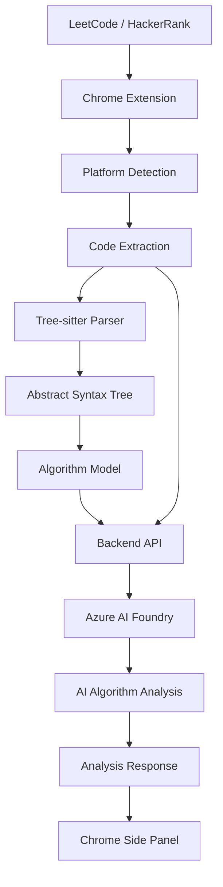

# AlgoLens 🚀
### AI-Powered Code Analysis Chrome Extension

<p align="center">
  Understand your code. Discover the algorithm. Improve your problem-solving.
</p>

<p align="center">
  
  
  
  
  
</p>

---

## 📌 Overview

**AlgoLens** is an AI-powered Chrome extension designed to help programmers understand their coding solutions on platforms like **LeetCode and HackerRank**.

Solving a coding problem is only part of the learning process. Understanding the algorithm, recognizing the underlying problem-solving pattern, and analyzing its complexity are equally important.

AlgoLens aims to bridge this gap by combining **AST-based code analysis using Tree-sitter with AI-powered reasoning**.

Instead of simply treating source code as text, AlgoLens extracts its underlying structure, builds a structured representation of the algorithm, and uses AI to generate meaningful insights.

## ✨ Key Features

- 🔍 **Automatic Platform Detection** – Detects supported coding platforms such as LeetCode and HackerRank.
- 📝 **Code Extraction** – Captures source code directly from the coding editor.
- 🌳 **AST-Based Parsing** – Uses Tree-sitter to parse source code and generate an Abstract Syntax Tree.
- 🧩 **Algorithm Model Generation** – Extracts functions, variables, loops, conditions, data structures and operations.
- 🧠 **AI-Powered Analysis** – Uses AI to understand algorithms and identify problem-solving patterns.
- ⏱️ **Complexity Analysis** – Provides time and space complexity estimates with explanations.
- 📖 **Code Explanation** – Helps programmers understand how their solutions work.
- 🖥️ **Interactive Side Panel** – Displays analysis within the browser.

## 🏗️ System Architecture



### How It Works

1. **Platform Detection:** Identifies whether the user is on a supported coding platform.
2. **Code Extraction:** Captures source code from the coding editor.
3. **AST Generation:** Tree-sitter parses the source code and generates its syntax tree.
4. **Algorithm Model:** Extracts relevant code constructs into a structured representation.
5. **AI Analysis:** The backend sends the source code and structural information to the AI model.
6. **Visualization:** Analysis is presented through the extension's side panel.

## 🛠️ Tech Stack

| Category | Technologies |
|---|---|
| Browser Extension | Chrome Extension Manifest V3 |
| Frontend | React.js, TypeScript |
| Styling | Tailwind CSS |
| Build Tools | Vite, CRXJS |
| Code Parsing | Tree-sitter |
| Backend | Backend API |
| AI Integration | Azure AI Foundry, GPT-4.1 mini |
| Version Control | Git, GitHub |

## 📂 Project Structure

```text
AlgoLens/
│
├── extension/
│   ├── src/
│   │   ├── manifest.ts
│   │   ├── background/
│   │   ├── content/
│   │   ├── popup/
│   │   └── sidepanel/
│   │
│   ├── public/
│   ├── package.json
│   └── vite.config.ts
│
├── backend/
│   └── ...
│
├── README.md
└── .gitignore
```

*The structure is illustrative. Update it to match the actual repository.*

## ⚙️ Installation and Setup

### Prerequisites

- Google Chrome
- Node.js and npm
- Git
- Visual Studio Code (recommended)

### 1. Clone the Repository

```bash
git clone https://github.com/YOUR_USERNAME/AlgoLens.git
cd AlgoLens
```

### 2. Install Dependencies

```bash
cd extension
npm install
```

### 3. Build the Extension

```bash
npm run build
```

### 4. Load the Extension in Chrome

1. Open Google Chrome.
2. Navigate to `chrome://extensions/`.
3. Enable **Developer mode**.
4. Click **Load unpacked**.
5. Select the generated `extension/dist` directory.
6. Open a supported coding platform and test the extension.

### 5. Backend and AI Configuration

For AI-powered functionality, configure the backend separately.

Store Azure credentials in backend environment variables. Never expose API keys in the Chrome extension or commit them to GitHub.

Example environment configuration:

```env
AZURE_AI_ENDPOINT=your_endpoint
AZURE_AI_API_KEY=your_api_key
AZURE_AI_DEPLOYMENT=gpt-4.1-mini
```

Do not commit your `.env` file.

## 📸 Screenshots

Add screenshots of the extension as development progresses.

| Feature | Screenshot |
|---|---|
| Extension Popup | Coming Soon |
| LeetCode Detection | Coming Soon |
| Code Analysis | Coming Soon |
| Algorithm Insights | Coming Soon |
| Side Panel | Coming Soon |

## 🗺️ Roadmap

- [x] Chrome extension project setup
- [x] LeetCode platform detection
- [x] Monaco editor code extraction
- [x] Tree-sitter integration
- [x] AST generation
- [x] Initial Algorithm Model generation
- [ ] Expand algorithm and pattern recognition
- [ ] Complete Azure AI backend integration
- [ ] Generate structured AI explanations
- [ ] Add detailed complexity analysis
- [ ] Improve side panel visualization
- [ ] Expand programming language support
- [ ] Add support for more coding platforms

## 🔮 Future Enhancements

- Interactive algorithm visualizations.
- Step-by-step execution explanations.
- Identification of common data structures and algorithmic patterns.
- Suggestions for optimizing inefficient solutions.
- Support for additional programming languages.
- Personalized learning insights based on coding activity.

## 🔐 Security and Privacy

- AI credentials are maintained on the backend.
- API keys should never be embedded in the browser extension.
- Source code should only be transmitted to the configured analysis backend with appropriate user awareness.
- Sensitive user data should not be stored unnecessarily.

## 🤝 Contributing

Contributions, suggestions and feedback are welcome!

1. Fork the repository.
2. Create a feature branch.

```bash
git checkout -b feature/your-feature
```

3. Commit your changes.

```bash
git commit -m "Add: your feature"
```

4. Push your branch.

```bash
git push origin feature/your-feature
```

5. Open a Pull Request.

## 👨‍💻 Author

**Karan Balaji**

Artificial Intelligence and Data Science  
BMS College of Engineering, Bengaluru

---

<p align="center">
  <b>AlgoLens — Don't just solve problems. Understand the algorithm behind them.</b>
</p>
